<div align="center">

<a href="https://github.com/ishandutta2007/Awesome-Specialized-Medical-Notetaking-Chart-Synthesis">
  
</a>

# 🩺 Awesome Specialized Medical Notetaking &amp; Chart Synthesis ⚡

**A Curated Ecosystem of Ambient Clinical AI Scribes, Speech-to-Chart Synthesis &amp; Open-Source Medical NLP Pipelines**

<p align="center">
  <a href="https://github.com/ishandutta2007/Awesome-Awesome-Awesome"></a><a href="https://discord.gg/jc4xtF58V"></a>
  <a href="https://github.com/ishandutta2007/Awesome-Specialized-Medical-Notetaking-Chart-Synthesis/stargazers"></a>
  <a href="https://github.com/ishandutta2007/Awesome-Specialized-Medical-Notetaking-Chart-Synthesis/network/members"></a>
  <a href="https://github.com/ishandutta2007/Awesome-Specialized-Medical-Notetaking-Chart-Synthesis/issues"></a>
  <a href="https://github.com/ishandutta2007/Awesome-Specialized-Medical-Notetaking-Chart-Synthesis/blob/main/LICENSE"></a>
  <a href="https://github.com/ishandutta2007"></a>
</p>

</div>

---

## 📖 Overview &amp; Abstract

**Specialized Medical Notetaking and Chart Synthesis** represents the vanguard of ambient healthcare technology. These systems listen to natural conversations between healthcare providers and patients, continuously extracting clinical context to automatically generate:
- 📝 **Structured SOAP Notes &amp; Consult Summaries**
- 🏷️ **ICD-10, CPT, HCC &amp; MCC Billing Code Suggestions**
- ✉️ **Referral Letters &amp; After-Visit Summaries (AVS)**
- 🏥 **EHR-Ready FHIR Resources &amp; Prior Authorization Drafts**

By eliminating 2 to 3 hours of daily manual keyboard charting ("pajama time"), ambient clinical documentation tools combat physician burnout, improve diagnostic accuracy, and return clinical focus to direct patient care.

---

## 📑 Table of Contents

- [📈 Sector Overview &amp; Market Dynamics](#-sector-overview--market-dynamics)
- [🏥 SaaS &amp; Enterprise Ambient AI Scribe Platforms](#-saas--enterprise-ambient-ai-scribe-platforms)
- [🔬 Open-Source Clinical NLP, Speech &amp; Scribe Projects](#-open-source-clinical-nlp-speech--scribe-projects)
- [🏗️ Architectural Blueprint: Self-Hosted Clinical Scribe Stack](#️-architectural-blueprint-self-hosted-clinical-scribe-stack)
- [🤝 How to Contribute](#-how-to-contribute)
- [💖 Support &amp; Sponsorship](#-support--sponsorship)
- [⚖️ Compliance &amp; Medical Disclaimer](#️-compliance--medical-disclaimer)
- [⭐ Star History](#-star-history)

---

## 📈 Sector Overview &amp; Market Dynamics

- **Market Size &amp; Growth Trajectory:** The global ambient clinical intelligence and medical documentation market is estimated at **$2.1 Billion in 2024** and is forecast to expand rapidly past **$8.9 Billion by 2030**, recording a compound annual growth rate (CAGR) of **~27.2%**.
- **Fragmentation vs. Concentration Dynamics:** The market currently displays **moderate fragmentation** across niche outpatient specialties and regional practice groups, but is rapidly transitioning into a **highly concentrated, winner-take-most platform ecosystem**. Category dominance is dictated by native, deep EHR integrations (especially Epic Systems, Oracle Health/Cerner, and MEDITECH) and strategic institutional partnerships (such as Abridge, Microsoft Nuance DAX, and Ambience Healthcare) which establish insurmountable workflow and compliance distribution moats.

---

## 🏥 SaaS &amp; Enterprise Ambient AI Scribe Platforms

The table below compiles leading commercial ambient clinical scribes, sorted in **descending order by company valuation / market capital**. Starting pricing tiers and trial limits are itemized with specific figures.

| 🏢 Platform / Vendor | 💰 Company Valuation / Size | 💵 Starting Pricing Tier | 🎁 Free Tier / Trial Limit | 🌟 Core Specialization &amp; EHR Compatibility |
| :--- | :--- | :--- | :--- | :--- |
| **[Microsoft Dragon Copilot (Nuance DAX)](https://www.microsoft.com/en-us/health-solutions/clinical-workflow)** | **$3.1T+ Market Cap** *(Parent Microsoft; acquired Nuance for $19.7B)* | **$150 / provider / month** *(ambient add-on with Dragon Medical One at $99/mo; enterprise tiers $200–$300/mo)* | **14-day evaluation license** via Microsoft Cloud for Healthcare partner sandbox program | Deep Epic, Cerner, &amp; MEDITECH native integration; agentic prior authorization and automated medication refills without physician intervention. |
| **[Abridge](https://www.abridge.com/)** | **$2.5B Valuation** *($460M+ raised from Lightspeed, IVP, Redpoint)* | **$200 / provider / month** *(outpatient standard tier; enterprise comprehensive suite $400–$800/mo)* | **14-day enterprise pilot** with full Epic Haiku/Hyperspace linked-evidence audit trail | Deepest Epic integration; real-time Linked Evidence audit trails clickable to source transcript audio; Availity prior authorization engine. |
| **[Ambience Healthcare](https://www.ambiencehealthcare.com/)** | **$1.2B Valuation** *($243M Series C led by Oak HC/FT &amp; Andreessen Horowitz)* | **$300 / provider / month** *(institutional contracts; ~$3,600/clinician/year starting base)* | **30-day health system pilot** (multi-specialty department clinical sandbox trial) | **Chart Awareness** pulls longitudinal patient history into documentation; point-of-care inpatient CDI; built-in HCC Compliance Validator. |
| **[Suki AI](https://www.suki.ai/)** | **~$450M Valuation** *($95M+ raised from Venrock, First Round, Flare Capital)* | **$199 / provider / month** *(Suki Ambient; standalone Suki Dictation starts at $99/provider/mo)* | **14-day free trial** with full EHR integration and unlimited practice encounters | Unbundled ambient and verbatim dictation; native embedding inside Epic and MEDITECH; KLAS-validated $2,600+ monthly financial impact. |
| **[Heidi Health](https://www.heidihealth.com/)** | **~$350M Valuation** *($65M Series B led by Point72)* | **$69.99 / month** *(Heidi Pro plan; billed monthly or £69.99/mo)* | **Free Forever plan**: Unlimited basic consult notes with 100 AI template generation tokens/mo | 2M+ consults weekly in 110 languages; dynamic learning adapts to physician tone and format; offline capture mode with cloud sync. |
| **[Nabla](https://www.nabla.com/)** | **~$180M Valuation** *($43M raised from Cathay Innovation &amp; DST Global)* | **$119 / provider / month** *(Nabla Pro with unlimited encounters and EHR Chrome extension)* | **Free Forever plan**: Up to 30 clinical encounters/month with note synthesis &amp; dictation | Browser-local audio processing with **zero audio retention by default**; 35+ languages; ICD-10, HCC, and MCC coding; open REST API. |
| **[DeepScribe](https://www.deepscribe.ai/)** | **~$150M Valuation** *($30M+ raised from Index Ventures)* | **$299 / provider / month** *(core outpatient specialty documentation plan)* | **14-day clinical trial** (capped at 50 processed patient encounters with chart review) | Specialty-tailored models (oncology, cardiology); context-aware pull-forward from historical patient visits; 99.92% note approval rating. |
| **[Augmedix (Commure)](https://www.augmedix.com/)** | **$139M Acquisition** *(Acquired by Commure / General Catalyst in 2024)* | **$249 / provider / month** *(Augmedix Go automated tier; hybrid Assist/Live tiers from $1,200/mo)* | **14-day clinical trial** (up to 30 patient encounters on Augmedix Go) | CareCues™ point-of-care gap reminders; compatibility with 50+ EHRs (Epic, Oracle Health, MEDITECH); HITRUST and HIPAA certified. |
| **[Robin Healthcare](https://www.robinhealthcare.com/)** | **~$120M Valuation** *($35M+ raised from Norwest Venture Partners)* | **$450 / provider / month** *(ambient transcription with human QA review)* | **30-day practice evaluation** (in-clinic trial with dedicated Robin Assistant device) | Proprietary in-room ambient hardware ("Robin Assistant"); hybrid human-in-the-loop review; automated orthopedics &amp; surgical billing codes. |
| **[Freed AI](https://www.getfreed.ai/)** | **~$50M Valuation** *($15M+ ARR, bootstrapped &amp; seed-backed)* | **$39 / month** *(Freed Starter for 40 notes/mo; Unlimited Core at $79/mo; Premier at $119/mo)* | **7-day free trial** (includes 10 full consult visits with note &amp; referral generation) | Instant self-serve setup; 1-click SOAP note transfer to any web or desktop EHR; customizable templates and automated patient instructions. |

---

## 🔬 Open-Source Clinical NLP, Speech &amp; Scribe Projects

For research laboratories, privacy-critical hospital networks, and developers engineering bespoke on-premises ambient documentation stacks, these open-source tools provide the essential building blocks. 

Listed below, strictly sorted in **descending order by GitHub star count**:

- **[Ollama](https://github.com/ollama/ollama)** [](https://github.com/ollama/ollama/stargazers)  
  Framework for locally serving quantized large language models (such as Meditron, Llama 3, and Mistral) with accelerated GPU/CPU execution. Vital for private, HIPAA-safe on-premises clinical SOAP note generation and FHIR serialization without external cloud dependencies.

- **[OpenAI Whisper](https://github.com/openai/whisper)** [](https://github.com/openai/whisper/stargazers)  
  Foundational multi-lingual automatic speech recognition (ASR) architecture trained on 680,000+ hours of speech. Highly adaptable to complex clinical vocabularies, anatomical terms, and multi-speaker dialogues.

- **[Whisper.cpp](https://github.com/ggerganov/whisper.cpp)** [](https://github.com/ggerganov/whisper.cpp/stargazers)  
  High-performance, pure C/C++ port of OpenAI Whisper with zero third-party dependencies. Enables ultra-fast, on-device clinical speech transcription directly on standard hospital workstations, thin clients, and edge tablets.

- **[faster-whisper](https://github.com/SYSTRAN/faster-whisper)** [](https://github.com/SYSTRAN/faster-whisper/stargazers)  
  Optimized Whisper reimplementation utilizing CTranslate2. Delivers up to 4x transcription speedups while reducing VRAM memory footprints by more than 50% for high-throughput clinical transcription servers.

- **[WhisperX](https://github.com/m-bain/whisperX)** [](https://github.com/m-bain/whisperX/stargazers)  
  Advanced speech recognition toolkit with phoneme-level forced alignment and PyAnnote-powered speaker diarization. Essential for separating patient questions from clinician assessments in ambient room recordings.

- **[SpeechBrain](https://github.com/speechbrain/speechbrain)** [](https://github.com/speechbrain/speechbrain/stargazers)  
  All-in-one PyTorch conversational speech toolkit featuring state-of-the-art neural speaker diarization, voice activity detection (VAD), and acoustic modeling tailored for complex medical dialogue processing.

- **[pyannote-audio](https://github.com/pyannote/pyannote-audio)** [](https://github.com/pyannote/pyannote-audio/stargazers)  
  Benchmark neural toolkit for speaker diarization, voice activity detection, and speaker overlap detection. Crucial for ambient hospital rooms where multiple doctors, nurses, patients, and family members speak concurrently.

- **[OpenEMR](https://github.com/openemr/openemr)** [](https://github.com/openemr/openemr/stargazers)  
  The leading ONC-certified open-source electronic health record (EHR) and practice management system. Features modern REST/FHIR APIs and pluggable module support for embedding custom ambient AI scribes directly into patient charts.

- **[Spark NLP for Healthcare](https://github.com/JohnSnowLabs/spark-nlp)** [](https://github.com/JohnSnowLabs/spark-nlp/stargazers)  
  Industrial clinical NLP library featuring 1,000+ pre-trained clinical models for entity recognition (clinical disorders, anatomy, dosages), relation extraction, assertion status (negation detection), and automated ICD-10-CM / RxNorm / SNOMED coding.

- **[MIMIC Code](https://github.com/MIT-LCP/mimic-code)** [](https://github.com/MIT-LCP/mimic-code/stargazers)  
  Official research code repository for the PhysioNet MIMIC critical care and emergency EHR database. Contains canonical clinical data processing scripts, concept extraction queries, and benchmarks for medical documentation models.

- **[Meditron](https://github.com/epfLLM/meditron)** [](https://github.com/epfLLM/meditron/stargazers)  
  Open-source suite of medical-adapted large language models (7B and 70B parameters) developed by EPFL. Fine-tuned on curated clinical guidelines and PubMed biomedical literature to deliver accurate medical reasoning and documentation synthesis.

- **[MedSpaCy](https://github.com/medspacy/medspacy)** [](https://github.com/medspacy/medspacy/stargazers)  
  Specialized clinical NLP extension built on top of spaCy. Includes targeted clinical pipeline modules for medical section header detection, TargetMatcher entity resolution, and ConText negation/uncertainty detection.

- **[fhir.resources](https://github.com/nazrulworld/fhir.resources)** [](https://github.com/nazrulworld/fhir.resources/stargazers)  
  Comprehensive Python Pydantic models for HL7 FHIR Release 4 &amp; 5 resources. Enables ambient scribe pipelines to convert raw generated clinical notes into valid FHIR `Encounter`, `Condition`, `Observation`, and `DocumentReference` objects.

- **[Apache cTAKES](https://github.com/apache/ctakes)** [](https://github.com/apache/ctakes/stargazers)  
  Apache clinical Text Analysis and Knowledge Extraction System. Battle-tested NLP system that maps unstructured medical narratives to UMLS ontologies, extracts medication timings, and analyzes disease history.

---

## 🏗️ Architectural Blueprint: Self-Hosted Clinical Scribe Stack

To engineer a private, HIPAA-compliant on-premises ambient medical documentation pipeline, integrate these open-source layers:

```
[ In-Room Clinician & Patient Encounter Audio ]
                     │
                     ▼
  1. Acoustic Voice Activity & Speaker Diarization
     └── pyannote-audio / SpeechBrain (distinguish Provider vs. Patient)
                     │
                     ▼
  2. Multi-Speaker Speech-to-Text Transcription
     └── faster-whisper / whisper.cpp (word timestamps + local acceleration)
                     │
                     ▼
  3. Clinical NLP & Concept Extraction
     └── MedSpaCy / Spark NLP (section header recognition, negation & UMLS tagging)
                     │
                     ▼
  4. Note Synthesis & Reasoning LLM
     └── Ollama + Meditron-70B / Llama 3 (SOAP note generation & AVS drafting)
                     │
                     ▼
  5. Interoperability & EHR Serialization
     └── fhir.resources -> OpenEMR / Epic FHIR APIs (DocumentReference & Condition push)
```

---

## 🤝 How to Contribute

Contributions from physicians, health informatics specialists, and AI researchers are welcome!

1. 🍴 **Fork this repository**
2. 🌿 **Create a descriptive branch** (`git checkout -b feature/add-ambient-tool`)
3. 📝 **Add or update an entry** in `README.md` (adhere to existing table formats, include factual pricing, free trial specifications, and valid links)
4. 🚀 **Submit a Pull Request** with a succinct description of your addition

> [!NOTE]
> Please review our [Awesome Curations](https://github.com/ishandutta2007/Awesome-Awesome-Awesome) community guidelines when proposing new additions.

---

## 💖 Support &amp; Sponsorship

Thank you so much for exploring and supporting the **Awesome Specialized Medical Notetaking &amp; Chart Synthesis** ecosystem! 🙏

If you find this curated collection helpful for your clinical workflow, medical AI research, startup, or hospital IT planning:
- ⭐ **Star this repository** to help clinicians and healthcare developers discover it
- 🍴 **Fork it** to extend or maintain your department's internal documentation tooling
- 📢 **Share it** on LinkedIn, X/Twitter, and medical informatics forums

### ☕ Sponsor the Project
Maintaining this curated index and tracking emerging ambient AI breakthroughs takes continuous effort. If you'd like to support the ongoing research:

<p align="left">
  <a href="https://github.com/sponsors/ishandutta2007">
    
  </a>
  <a href="https://github.com/sponsors/ishandutta2007">
    
  </a>
</p>

You can sponsor directly via the **[GitHub Sponsors Dashboard](https://github.com/sponsors/ishandutta2007)**. Every bit of support makes a tremendous difference!

---

## ⚖️ Compliance &amp; Medical Disclaimer

- **Informational Resource Only:** This repository is an open community-curated research directory and does not constitute medical advice or clinical endorsement.
- **Regulatory Compliance:** All clinical documentation, ambient voice capture, and chart synthesis software must strictly comply with regional data privacy laws including **HIPAA**, **HITECH**, **GDPR**, and local healthcare privacy mandates.
- **Human-in-the-Loop Requirement:** **All AI-generated clinical notes, diagnostic suggestions, and billing codes must be thoroughly reviewed and authenticated by licensed healthcare professionals** before final sign-off into the legal Electronic Health Record (EHR).
- **Patient Consent:** Explicit patient consent should always be obtained prior to recording or transcribing clinical encounters in accordance with local single-party or two-party consent statutes.

---

## ⭐ Star History

[](https://star-history.dera.page/#ishandutta2007/Awesome-Specialized-Medical-Notetaking-Chart-Synthesis&type=date&legend=top-left)

---

<div align="center">
  <sub>Built with ❤️ for clinicians, health system informatics leaders, and healthcare AI builders worldwide.</sub>
</div>
